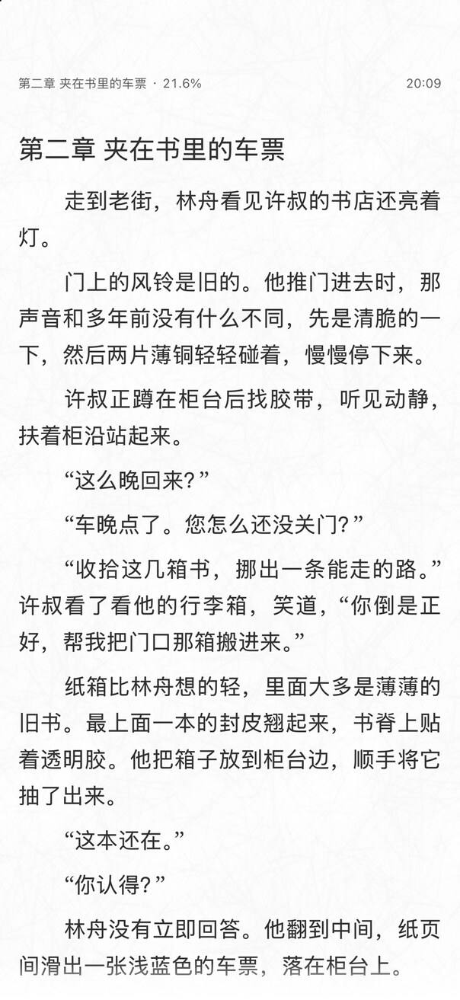

# 月读 · Moonread

安静阅读自己的 TXT 小说。月读是一款面向 iPhone 和 iPad 的本地阅读器，免费、无广告、开源，没有书城，也不分发小说。导入你的文件，就能从上次读到的地方继续。

用 iCloud 同步小说与阅读记录，在不同设备间接着读；用浅深配色、纯黑夜间和纸张纹理，配合字号、行距与滚动/分页阅读，找到舒服的版面。书签、批注、标签和阅读数据备份，让自己的书库更好整理。

*A free, ad-free, open-source TXT reader for iPhone and iPad, with iCloud sync and customizable reading themes.*

[在 App Store 下载](https://apps.apple.com/app/id6823849812) · [访问官网](https://suxiaoshao.github.io/moonread/)

1.2 阅读画面 · 原创示例内容

代码采用 [MIT 许可证](LICENSE)；第三方素材与依赖见[资源及许可说明](THIRD_PARTY_NOTICES.md)。

开发与贡献请从 [CONTRIBUTING.md](CONTRIBUTING.md) 进入，完整规范见[开发文档](docs/dev/README.md)。
