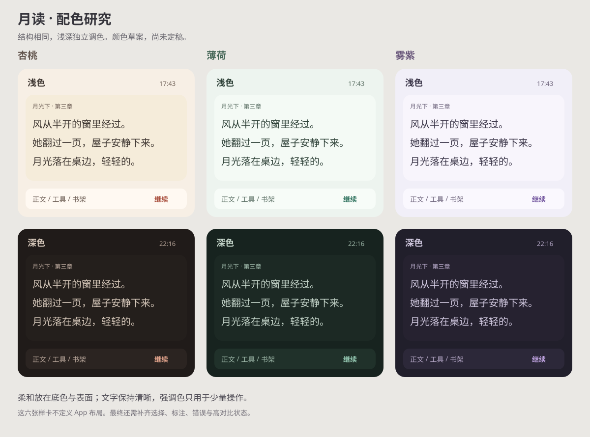

# 主题与产品化设计入口

更新：2026-10-02。App 与阅读支持独立明暗、系统/预设/自定义配色，设置页、阅读预览、原生启动页和月亮组件已接入；当前角色与尺寸来源见[样式盘点](ui-inventory.md)。实际验证范围见[验证记录](../engineering/verification.md)。

## 用户已明确的方向

- 边框、间距等结构规则统一；每个主题的颜色独立设计，改善 App 外壳与阅读器的割裂。
- App 可设置浅色、深色主题；阅读可跟随 App，也可独立设置浅深主题。
- App 配色可使用系统或自己的配色；阅读配色可跟随系统、App 或独立配色。
- 预设应有明快、温软、可爱的感觉，长文阅读轻松；可读性和正文空间继续优先。
- 增加设置入口，规划完整设置入口，补齐状态变化与转场动效。
- 完整月亮用于品牌、阅读扉页、适合的空态和阅读助手；保留无眼睛、完整圆月、无额外外框的形象。等待使用系统进度指示，不用月亮。
- 参考 gpui-component 的主题类型、Apple 规范和 iOS 社区一手文章；Rust 业务 / Swift UI 分工不变。

## 阅读顺序

| 文档 | 内容 |
| --- | --- |
| [样式盘点](ui-inventory.md) | 现有颜色、材质、边框、圆角、间距、字体、加载与动画的源码位置 |
| [主题模型](themes.md) | 结构 token、明暗/配色来源、Rust 类型契约、继承解析、三组各含浅深两套的配色和 iOS 作用域 |
| [设置页](settings.md) | 书架/设置的顶层结构、当前入口与持续偏好 |
| [动效与月亮](motion-and-moon.md) | 动效规则、加载与真实进度、启动白屏衔接与月亮的角色 |
| [调研依据](../research/theme-references.md) | gpui-component 固定源码、Apple 和社区文章，以及采用范围 |
| [应用图标](app-icon.md) | 已确认 SVG 母版、`.icon` 与既有验证 |

## 默认与实际行为

- 把明暗模式与配色来源分开，浅深槽位独立保存；初始阅读完全继承 App。同一主题有协调的书架 canvas、面板 surface 和阅读 paper，不要求所有底色相同。
- 提供杏桃、薄荷、雾紫三组浅深配色，另有纯黑夜间（深色）、素白和豆沙绿（浅色）；均沿用现有派生色与高对比规则，默认仍为杏桃。
- 设置首页按阅读、书架与同步、AI 助手（无标题单行分组）、应用、独立关于组排列；“应用外观”包含应用明暗、浅深配色与减弱动态效果，阅读纸面配色留在阅读设置。首页摘要和当前设置结构见[设置页](settings.md)，不预放尚不可用的入口。

草图比较颜色方向，不代表最终组件布局。当前颜色以 Rust 定义为准；数值与检查范围见主题模型。

## 共同边界

配色变化只更新绘制，不改变正文边距、字号、段间距、章节排版或索引。排版与阅读控制已在统一阅读设置中实现，规则见[正文](../reader/reading.md)；持续索引、时间/电量更新和高亮绘制不能因为主题观察而触发全文布局。

功能文档记录当前规则，未实现的配色交换等能力集中在[后续计划](../roadmap.md)，截图/交互证据与辅助功能矩阵缺口集中在[验证记录](../engineering/verification.md)。

普通操作继续优先 SF Symbols，图标按钮保留本地化名称；月亮用于品牌、空态与阅读助手，不表示等待，不代替返回、书签、删除等功能含义，也不兼任夜间开关；对话 Tab 使用标准对话气泡符号。系统组件、新 API 和最低部署策略沿用[iOS 支持策略](../engineering/ios-support.md)。
